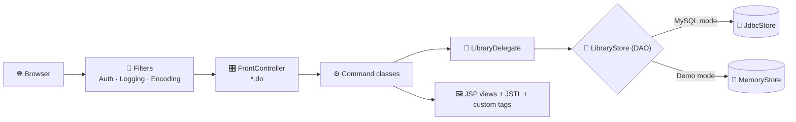
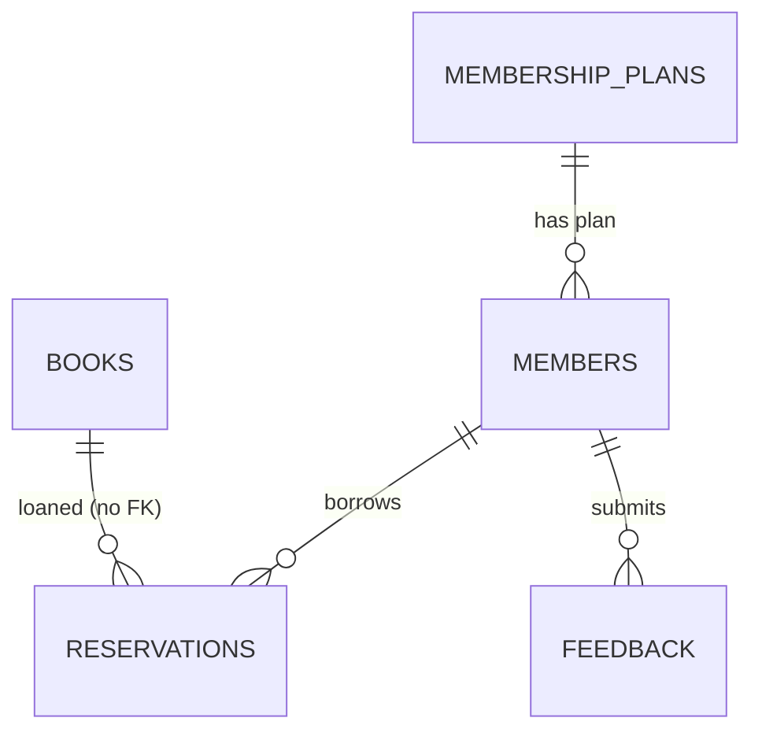

<<<<<<< HEAD
<div align="center">


<a href="https://github.com/Isuru-CodeX/BookVerse">
  
</a>

<br/>

<p>
  
  
  
  
  
</p>

<p>
  
  
  
  
</p>

<p>
  <a href="#-features"><b>✨ Features</b></a> •
  <a href="#-architecture"><b>🏗️ Architecture</b></a> •
  <a href="#-getting-started"><b>🚀 Get Started</b></a> •
  <a href="#-membership-plans"><b>💳 Plans</b></a> •
  <a href="#-database-design"><b>🗄️ Database</b></a> •
  <a href="#-roadmap"><b>🗺️ Roadmap</b></a>
</p>

</div>

---

## 📚 About

**BookVerse** is a JSP-based Java EE web application for library management, built for **HF2K – Web Component Development II (Component A)**. It shows off **Servlet 4.0, JSP 2.3, EL 3.0 and JSTL 1.2** in a realistic app with two audiences: **library members** and **administrative staff**.

> 💡 **Zero-setup friendly:** BookVerse runs in two persistence modes, a **MySQL database mode** (recommended) and an automatic **in-memory demo mode** that kicks in when no database is reachable.

<!--
📸 SCREENSHOTS: add your images to an /assets folder, then uncomment this block.

<div align="center">
  
  
  
  
</div>
-->

---

## ✨ Features

### 👤 Member Portal

| | Feature | What you can do |
|---|---|---|
| 🔎 | **Catalogue search** | Browse and search the book catalogue dynamically, with highlighted matches |
| 📖 | **Reserve and return** | Borrow a title, return it, and keep a reading history |
| 🔄 | **Renewals** | Renew active loans within your plan's renewal limit |
| 💳 | **Membership plans** | Switch between Standard, Premium and Student tiers |
| 💬 | **Feedback and news** | Submit feedback and read library announcements |

### 🛡️ Admin (Staff) Panel

| | Tab | What staff can do |
|---|---|---|
| 📊 | **Overview** | Key stats, overdue loans, sold-out titles |
| 📚 | **Books** | Search, add, edit and delete catalogue entries |
| 👥 | **Members** | Update plans and roles, suspend accounts, reset passwords, view loan history |
| 🔁 | **Loans** | Supervise active, overdue and returned loans; force-return or extend due dates |
| 🧾 | **Plans** | Edit booking rules for every membership tier live |
| 📢 | **Announcements and feedback** | Publish news to the home page and review member feedback |
| 📈 | **Reports** | Most borrowed books and inventory distribution |

---

## 🏗️ Architecture



| Pattern | Where it lives |
|---|---|
| **MVC** | `model/`, `bean/`, `service/` · JSP views · `FrontController` + `command/` |
| **Front Controller** | `FrontController` intercepts every `.do` request and delegates to a `Command` |
| **Command** | `Command` interface with 26 implementing classes |
| **DAO** | `LibraryStore` implemented by `JdbcStore` (MySQL) and `MemoryStore` (in-memory) |
| **Intercepting Filters** | `AuthFilter`, `LoggingFilter`, `EncodingFilter` |
| **Business Delegate and Service Locator** | `LibraryDelegate`, `ServiceLocator` |
| **Listeners** | `AppContextListener`, `SessionCountListener` |

**Core domain models:** 📘 `Book` · 👤 `Member` (roles `STAFF` / `MEMBER`) · 🪪 `MembershipPlan` · 🔖 `Reservation` (a loan and its lifecycle)

---

## 🛠️ Tech Stack

<div align="center">


</div>

| Layer | Technologies |
|---|---|
| **Frontend** | HTML, CSS, JavaScript, JSP 2.3, EL 3.0, JSTL 1.2, custom tags and tag files |
| **Backend** | Java EE (Servlet 4.0), Java 11+ |
| **Database** | MySQL 8 or MariaDB |
| **Tools** | Maven 3.6+, Apache Tomcat 9.x, Git |

---

## 🚀 Getting Started

### ✅ Prerequisites

- ☕ JDK 11 or higher
- 📦 Maven 3.6+
- 🐱 Apache Tomcat **9.x**

  > ⚠️ Tomcat 9 uses the `javax.*` namespace. Tomcat 10+ needs `jakarta.*`.

- 🐬 MySQL 8 / XAMPP / MariaDB *(optional, for database mode)*

### 📥 Installation

```bash
# 1️⃣ Clone the repository
git clone https://github.com/Isuru-CodeX/BookVerse.git
cd BookVerse

# 2️⃣ Build the WAR (includes the MySQL JDBC driver)
mvn clean package
```

### 🗄️ Database setup *(MySQL mode)*

```bash
mysql -u root -p < database/bookverse.sql
```

This creates the `bookverse` database, tables and user, and loads sample data (14 titles, 3 plans).

### ⚙️ Configuration

Connection settings live in `src/main/webapp/WEB-INF/web.xml`:

```xml
<env-entry>
    <env-entry-name>db.url</env-entry-name>
    <env-entry-type>java.lang.String</env-entry-type>
    <env-entry-value>jdbc:mysql://localhost:3306/bookverse?useSSL=false&amp;allowPublicKeyRetrieval=true&amp;serverTimezone=Asia/Colombo</env-entry-value>
</env-entry>
```

Or override with environment variables:

```bash
BOOKVERSE_DB_URL=jdbc:mysql://localhost:3306/bookverse
BOOKVERSE_DB_USER=your_username
BOOKVERSE_DB_PASSWORD=your_password
BOOKVERSE_DB_DRIVER=com.mysql.cj.jdbc.Driver
```

> 🧠 **In-memory mode:** leave `db.url` empty or simply don't start MySQL. Data resets on every restart.

### ▶️ Run it

1. Copy `target/bookverse.war` into `<TOMCAT_HOME>/webapps/`
2. Start Tomcat and open **http://localhost:8080/bookverse/**
3. Check the page footer. It should say **"Data store: MySQL database"** (or the in-memory fallback)

### 🔑 Demo accounts

| Role | Email | Password |
|---|---|---|
| 👤 Member | `member@bookverse.lk` | `member123` |
| 🛡️ Staff | `admin@bookverse.lk` | `admin123` |

---
=======
# BookVerse Online Library Portal

**HF2K – Web Component Development II · Component A (Web Application Development Project)**

Welcome to the BookVerse Online Library Portal! This project is a robust, JSP-based Java EE web application designed to demonstrate the power of Servlet 4.0, JSP 2.3, EL 3.0, and JSTL 1.2. The portal provides a comprehensive platform for library management, catering to both library members and administrative staff.

It seamlessly supports two data persistence modes: a recommended MySQL database mode for production-like environments, and an automatic fallback in-memory demo mode, ensuring hassle-free execution and exploration.

## Table of Contents

- [Features](#features)
- [Architecture & Design Patterns](#architecture--design-patterns)
- [Core Domain Models](#core-domain-models)
- [Technologies Used](#technologies-used)
- [Getting Started](#getting-started)
  - [Prerequisites](#prerequisites)
  - [Installation](#installation)
  - [Database Setup](#database-setup-mysql-database-mode)
  - [Configuration](#configuration)
  - [Running the Project](#running-the-project)
- [Project Structure](#project-structure)
- [Application Details & Mappings](#application-details--mappings)
  - [Application Map](#application-map)
  - [Database Design](#database-design)
  - [Membership Plans](#membership-plans-booking-data-per-plan)
  - [Assessment Requirements Implementation](#where-each-assessment-requirement-is-implemented)
- [Testing](#testing)
- [Known Issues & Assumptions](#known-issues-assumptions)
- [Future Improvements](#future-improvements)
- [Contributing](#contributing)
- [License](#license)

## Features

- **Dual Modes:** Runs with a MySQL database for persistent storage (recommended), or automatically falls back to an in-memory demo mode (which resets on every restart) if no database is reachable.
- **Member Features:**
  - Browse and search the book catalogue dynamically.
  - Reserve and return books efficiently.
  - Manage membership plans (Standard, Premium, Student) and renew active loans.
  - Submit detailed feedback and view library announcements.
- **Admin (Staff) Panel:**
  - **Overview:** View crucial statistics, manage overdue loans, and monitor sold-out titles.
  - **Books:** Comprehensive catalogue management (Search, add, edit, delete).
  - **Members:** Manage user accounts, update membership plans and roles, toggle account statuses, and perform password resets. View complete member loan histories.
  - **Loans:** Supervise all active, overdue, and returned loans. Force returns or extend due dates manually.
  - **Plans:** Dynamically edit booking rules for all membership tiers.
  - **Announcements & Feedback:** Publish important news to the home page and review member feedback.
  - **Reports:** Analyze system-wide statistics (e.g., most borrowed books, inventory distribution).

## Architecture & Design Patterns

The application adheres strictly to standard Java EE architectural patterns:

- **Model-View-Controller (MVC):** Separation of concerns is maintained with models representing data, JSP serving as views, and a sophisticated controller managing the flow.
- **Front Controller Pattern:** All `.do` requests are intercepted by a central `FrontController`, which delegates to specific `Command` classes (e.g., `CatalogCommand`, `AdminCommand`).
- **Data Access Object (DAO) Pattern:** The `LibraryStore` interface defines data operations, implemented concretely by `JdbcStore.java` for MySQL and `MemoryStore.java` for in-memory operations.
- **Intercepting Filters:** Filters like `AuthFilter.java`, `LoggingFilter.java`, and `EncodingFilter.java` process requests globally for security, auditing, and character encoding respectively.

## Core Domain Models

- **Books:** Represents catalogue entries, tracking details, total copies, and available copies.
- **Members:** User accounts handling authentication, roles (STAFF, MEMBER), and linking to a specific membership plan.
- **Membership Plans:** Define the business rules (e.g., active loan limits, loan durations, renewal limits) applicable to a member.
- **Reservations:** The transactional model representing a loan. It tracks the relationship between a book, a member, and the loan lifecycle (dates, status).

## Technologies Used

- **Frontend:** HTML, CSS, JavaScript, JSP 2.3, EL 3.0, JSTL 1.2, Custom Tags
- **Backend:** Java EE (Servlet 4.0), Java 11+
- **Database:** MySQL 8 (or MariaDB)
- **Tools:** Git, Maven 3.6+, Apache Tomcat 9.x, standard IDEs

## Getting Started

Follow these steps to set up and run the BookVerse application locally.

### Prerequisites

- JDK 11 or higher
- Maven 3.6+
- Apache Tomcat 9.x
- MySQL 8 (or XAMPP / MariaDB) - optional, for database mode

> **Note:** Tomcat 9 uses the `javax.*` namespace. Tomcat 10+ needs `jakarta.*`.

### Installation

1. **Clone the repository:**
   ```bash
   git clone <YOUR_REPOSITORY_URL>
   ```

2. **Open the project directory:**
   ```bash
   cd bookverse-portal
   ```

3. **Build the project using Maven:**
   ```bash
   mvn clean package
   ```
   *This compiles the code and packages it into `target/bookverse.war`, including the required MySQL JDBC driver (`mysql-connector-j`).*

### Database Setup (MySQL Database Mode)

1. **Install and start** your MySQL 8 (or MariaDB) server.
2. **Import the database file:** Open a terminal in the project folder and run:
   ```bash
   mysql -u root -p < database/bookverse.sql
   ```
   This creates the `bookverse` database, tables, user, and populates sample data.

### Configuration

Check connection settings in `src/main/webapp/WEB-INF/web.xml`:
```xml
<env-entry>
    <env-entry-name>db.url</env-entry-name>
    <env-entry-type>java.lang.String</env-entry-type>
    <env-entry-value>jdbc:mysql://localhost:3306/bookverse?useSSL=false&allowPublicKeyRetrieval=true&serverTimezone=Asia/Colombo</env-entry-value>
</env-entry>
```
Override via environment variables if needed:
```env
BOOKVERSE_DB_URL=jdbc:mysql://localhost:3306/bookverse
BOOKVERSE_DB_USER=your_username
BOOKVERSE_DB_PASSWORD=your_password
BOOKVERSE_DB_DRIVER=com.mysql.cj.jdbc.Driver
```
*For In-memory mode:* Set `db.url` to empty or do not start MySQL.

### Running the Project

1. **Deploy:** Copy `target/bookverse.war` to `<TOMCAT_HOME>/webapps/`.
2. **Start Tomcat:** Open your browser to `http://localhost:8080/bookverse/`.
3. **Verify:** Check the page footer for "Data store: MySQL database".
4. **Demo Accounts:**
   - Member: `member@bookverse.lk` / `member123`
   - Staff: `admin@bookverse.lk` / `admin123`

## Project Structure

```text
bookverse-portal/
├── src/
│   └── main/
│       ├── java/          # Java source code (Controllers, Models, DAOs, Services)
│       └── webapp/        # Web resources (JSP views, CSS, JS, WEB-INF)
├── database/              # SQL scripts for database schema and sample data
├── pom.xml                # Maven configuration and dependencies
└── README.md              # Project documentation
```

## Application Details & Mappings

### Application Map
>>>>>>> 77c4d5d81c7b008b76b62b376b3baf72d16e339e

## 💳 Membership Plans

| Rule | 🥉 Standard | 🥇 Premium | 🎓 Student |
|---|:---:|:---:|:---:|
| Active loans at once | 3 | 8 | 5 |
| Book loan period | 14 days | 28 days | 21 days |
| Journal / magazine loan | 7 days | 14 days | 10 days |
| Renewals per loan | 1 | 3 | 2 |
| Monthly fee | Rs. 500 | Rs. 1,500 | Free |

*These are defaults. Staff can edit every value on the **Plans** tab, and changes apply immediately to new reservations and renewals.*

---

## 🗄️ Database Design



| Table | Purpose | Key columns |
|---|---|---|
| `membership_plans` | Booking rules per plan | PK `type` (STANDARD / PREMIUM / STUDENT) |
| `members` | Accounts (staff and members) | PK `id`, unique `email`, FK `membership_type` |
| `books` | Catalogue | PK `id`, CHECK `available_copies <= total_copies` |
| `reservations` | Loans and history | PK `id`, FK `member_email`, indexes on `book_id`, `status` |
| `announcements` | Home page news | PK `id` |
| `feedback` | Member feedback | PK `id`, CHECK `rating` 1–5 |

> ℹ️ `reservations.book_id` is intentionally **not** a foreign key, so loan history survives when a title is deleted.

---

## 📂 Project Structure

```bash
BookVerse/
├── 📁 src/main/
│   ├── 📁 java/        # Controllers, commands, models, DAOs, services, filters
│   └── 📁 webapp/      # JSP views, CSS, JS, WEB-INF (web.xml, tld, tags)
├── 📁 database/        # bookverse.sql (schema + sample data)
├── 📄 pom.xml          # Maven build
└── 📄 README.md
```

<details>
<summary><b>🧭 Application map (click to expand)</b></summary>

<br/>

| URL | Command | View |
|---|---|---|
| `/` , `index.jsp` | `jsp:forward` → `home.do` | – |
| `home.do` | `HomeCommand` | `views/home.jsp` |
| `catalog.do` | `CatalogCommand` | `views/catalog.jsp` |
| `bookDetail.do?id=` | `BookDetailCommand` | `views/bookDetail.jsp` |
| `login.do` / `logout.do` | `LoginCommand` / `LogoutCommand` | `views/login.jsp` |
| `register.do` | `RegisterCommand` | `views/register.jsp` |
| `dashboard.do` *(member)* | `DashboardCommand` | `views/dashboard.jsp` |
| `reserve.do`, `return.do` *(POST)* | `ReserveCommand`, `ReturnBookCommand` | redirect |
| `plans.do` | `PlansCommand` | `views/plans.jsp` |
| `renew.do`, `changePlan.do` *(POST)* | `RenewCommand`, `ChangePlanCommand` | redirect |
| `admin*.do` *(STAFF only)* | `AdminCommand` and related | `admin.jsp`, `adminBooks.jsp`, `adminMembers.jsp`, `adminLoans.jsp`, `adminPlans.jsp`, `adminAnnouncements.jsp`, `adminFeedback.jsp`, `adminReports.jsp` |
| `elDemo.do` | `ElDemoCommand` | `views/elDemo.jsp` |
| any error / 403 / 404 / 500 | `<error-page>` | `error.jsp` |

**26 JSP files** in total (minimum required: 8).

<<<<<<< HEAD
</details>

<details>
<summary><b>🎓 Where each assessment requirement is implemented (click to expand)</b></summary>

<br/>

| Requirement | Where to look |
|---|---|
| EL implicit objects, `.` and `[]` operators | `views/elDemo.jsp` |
| `jsp:useBean`, `setProperty`, `getProperty` | `catalog.jsp`, `login.jsp`, `register.jsp`, `dashboard.jsp`, `bookDetail.jsp`, `feedback.jsp` |
| `jsp:include` / `jsp:forward` / `jsp:param` | every view, `index.jsp`, `feedback.jsp` |
| JSTL core, `fn:` and `fmt:` | across the views |
| No scriptlets | enforced by `<scripting-invalid>true` in `web.xml` |
| Custom tags | `RatingTag`, `AvailabilityTag`, `HighlightTag` in `WEB-INF/tld/bookverse.tld` |
| Tag files | `card.tag`, `alert.tag`, `pageHeader.tag`, `bookcard.tag`, `elrow.tag`, `adminNav.tag` |
| Security basics | HTML escaping, whitelist redirects, session id change, HttpOnly cookies, POST for state changes, salted password hashes |

</details>

---

## 🧪 Testing

A 33-point **manual test checklist** is documented in the project. Highlights:

- ✅ Search, sort and highlight in the catalogue
- ✅ Custom 404 for invalid book ids, 403 for members opening admin URLs
- ✅ Loan limits, renewals and plan switching enforced per tier
- ✅ XSS payloads in the search box are escaped
- ✅ App still starts (with a warning) if the database is unreachable

```bash
mvn test   # if automated tests are added
```

---

## ⚠️ Known Issues and Assumptions

- A "reservation" is an immediate loan of one copy; limits come from the member's plan.
- Student status is not verified in software (staff check ID at the desk).
- Only two roles exist: `MEMBER` and `STAFF`. Staff accounts are pre-created.
- Ratings are static editorial scores. Members can't rate books yet.
- Passwords use **salted SHA-256** for the demo instead of BCrypt.

---

## 🗺️ Roadmap

- [x] MVC with Front Controller, Command and DAO patterns
- [x] MySQL mode with in-memory fallback
- [x] Full admin dashboard and membership plan editor
- [ ] Connection pooling (HikariCP / Tomcat JDBC pool) and JPA
- [ ] CSRF tokens and BCrypt password hashing
- [ ] Pagination, waiting lists and email notifications
- [ ] REST / JSON API
- [ ] Internationalization with `fmt:message`
- [ ] Unit tests for the service layer
- [ ] Caching of catalogue queries
- [ ] Migration to Jakarta EE 10 / Tomcat 10

---

## 🤝 Contributing

Contributions are welcome!

1. 🍴 Fork the repository
2. 🌿 Create a branch: `git checkout -b feature-name`
3. 💾 Commit: `git commit -m "Add some feature"`
4. 📤 Push: `git push origin feature-name`
5. 🔃 Open a Pull Request

## 📜 License

Created for educational purposes as part of the **HF2K Web Component Development II** assessment.

---

<div align="center">

### 📬 Connect with me

<a href="https://github.com/Isuru-CodeX"></a>

⭐ **If you like BookVerse, give it a star!** ⭐


</div>
=======
### Database Design
| Table | Purpose | Key columns |
|---|---|---|
| `membership_plans` | booking rules per plan | PK `type` (STANDARD / PREMIUM / STUDENT) |
| `members` | accounts (staff and members) | PK `id`, unique `email`, FK `membership_type` -> plans |
| `books` | catalogue | PK `id`, CHECK `available_copies <= total_copies` |
| `reservations` | loans and history | PK `id`, FK `member_email` -> members(email), index on `book_id`, `status` |
| `announcements` | home page news | PK `id` |
| `feedback` | member feedback | PK `id`, CHECK `rating` 1-5 |

`reservations.book_id` is intentionally not a foreign key, so loan history survives when a title is deleted.

### Membership Plans (booking data per plan)
| Rule | Standard | Premium | Student |
|---|---|---|---|
| Active loans at once | 3 | 8 | 5 |
| Book loan period | 14 days | 28 days | 21 days |
| Journal / magazine loan | 7 days | 14 days | 10 days |
| Renewals per loan | 1 | 3 | 2 |
| Monthly fee | Rs. 500 | Rs. 1,500 | Free |

These are defaults; staff can edit all values on the **Plans** tab and the change applies immediately to new reservations and renewals.

### Where each assessment requirement is implemented

| Requirement | Where to look |
|---|---|
| **EL implicit objects** | `views/elDemo.jsp` (live table, one row per expression). |
| EL `.` and `[]` operators | `elDemo.jsp` section 5 |
| `jsp:useBean` | `catalog.jsp`, `login.jsp`, `register.jsp`, `dashboard.jsp`, `bookDetail.jsp`, `feedback.jsp`, `footer.jsp` |
| `jsp:setProperty` | `feedback.jsp`, `login.jsp`, `register.jsp`, `bookDetail.jsp` |
| `jsp:getProperty` | `catalog.jsp`, `bookDetail.jsp`, `dashboard.jsp`, `feedbackThanks.jsp` |
| `jsp:include` + `jsp:param` | every view (header/footer), `elDemo.jsp` (`note.jsp`) |
| `jsp:forward` + `jsp:param` | `index.jsp`, `feedback.jsp` |
| `jsp:attribute` | `home.jsp`, `elDemo.jsp` |
| JSTL core | `c:set, c:out, c:if, c:choose/when/otherwise, c:forEach (varStatus), c:forTokens, c:remove, c:url, c:param`; also `fn:` and `fmt:formatDate` |
| No scriptlets | enforced by `<scripting-invalid>true` in `web.xml` |
| Custom tags (handlers) | `RatingTag`, `AvailabilityTag`, `HighlightTag` – declared in `WEB-INF/tld/bookverse.tld` |
| Tag files | `WEB-INF/tags/`: `card.tag`, `alert.tag`, `pageHeader.tag`, `bookcard.tag`, `elrow.tag`, `adminNav.tag` |
| Scopes | application, session, request, page scopes utilized heavily |
| MVC (mandatory) | Model: `model/`, `bean/`, `service/` · View: JSP · Controller: `FrontController` + `command/` |
| Front Controller | `controller/FrontController.java` (`*.do`) |
| Command | `command/Command.java` and 26 implementing classes |
| Intercepting Filter | `EncodingFilter`, `LoggingFilter`, `AuthFilter` |
| Business Delegate | `service/LibraryDelegate.java` |
| Data Access Object (DAO) | `data/LibraryStore.java`, `JdbcStore.java`, `MemoryStore.java` |
| Service Locator | `service/ServiceLocator.java` |
| Transfer Object | `Book, Member, MembershipPlan, Reservation, Announcement` (Serializable) |
| Listeners | `AppContextListener`, `SessionCountListener` |
| Error handling & validation | `error.jsp` + `<error-page>`; `RegistrationForm.validate()`, `FeedbackBean.getErrors()`, `AddBookCommand` |
| Security basics | HTML escaping, whitelist redirect after login, session id change, HttpOnly cookies, POST for state changes, salted password hashes |

## Testing

A manual test checklist is provided to verify system functionality during development:

| # | Test | Expected |
|---|---|---|
| 1 | Open `/bookverse/` | Home page via `jsp:forward`; visit counter in footer increases |
| 2 | Catalogue → search `java`, sort by rating | Matches highlighted with `<mark>` |
| 3 | Catalogue → keyword `zzzz` | "No titles match" alert |
| 4 | Open `bookDetail.do?id=999` / `id=abc` | Custom 404 page |
| 5 | Open `dashboard.do` when signed out | Redirect to login with return address |
| 6 | Sign in with wrong password | Error message, email kept |
| 7 | Sign in as member → reserve a title | Flash message, loan on dashboard, copies reduced |
| 8 | Reserve a 4th title | Loan-limit message |
| 9 | Reserve a title with 0 copies | Button disabled / error message |
| 10 | Return a title | Moves to reading history, copies restored |
| 11 | Member opens `admin.do` | 403 page |
| 12 | Register with bad data | Five field-level errors |
| 13 | Register with an existing email | "already exists" message |
| 14 | Staff → add title with empty fields | Field errors; valid input adds the title |
| 15 | Staff → post announcement | Appears on home page |
| 16 | `feedback.jsp` invalid then valid | Errors, then thank-you page (`jsp:forward`) |
| 17 | `elDemo.do?q=Hello&tag=java&tag=jsp` | `param`, `paramValues` rows populated |
| 18 | `catalog.do?keyword=<script>` | Text is escaped, nothing executes |
| 19 | Staff -> Plans: set Standard book loan to 10 days, save | Plans page and new loans use 10 days; limit 99 is rejected |
| 20 | Member (Standard) renews a loan twice | First succeeds ("1 / 1"), second refused |
| 21 | Member switches to Premium | Loan limit 8, book page shows 28-day due date |
| 22 | Member with 8 loans switches back to Standard | Refused (limit 3) |
| 23 | Staff -> Members: suspend a member | Member's next request signs them out; login shows "suspended" |
| 24 | Staff edits own account to Member role | "You cannot suspend or demote your own account" |
| 25 | Staff -> Books: delete a title that is on loan | Refused; unloaned title deletes |
| 26 | Staff -> Loans -> Return / +7 days | Copies restored / due date moved |
| 27 | Staff resets a member's password | Member can log in with the new one |
| 28 | Member opens any `admin*.do` URL | 403 page |
| 29 | Import `database/bookverse.sql`, start the app | Footer: "Data store: MySQL database"; 14 titles, 3 plans |
| 30 | Reserve a book, then `SELECT * FROM reservations` | New loan row; `books.available_copies` reduced in the same transaction |
| 31 | Staff edits the Premium plan, restart Tomcat | New values still shown on the Plans page |
| 32 | Add a title with unicode characters (e.g. "Café"), restart | Title still correct (utf8mb4) |
| 33 | Start with a wrong database password | Application still starts, footer says "database unavailable", error in log |

*(To run automated tests, if implemented, use `mvn test`)*

## Known Issues & Assumptions

- A "reservation" is an immediate loan of one copy; limits and periods come from the member's plan.
- Student status for membership plans is not verified in software (library staff check student ID at the desk).
- Two roles only: MEMBER and STAFF. Staff accounts are pre-created.
- Ratings are static editorial scores; members cannot rate books currently.
- Passwords use salted SHA-256 for the demo environment instead of more secure algorithms like BCrypt.

## Future Improvements

- Connection pool (HikariCP / Tomcat JDBC pool) and JPA integration.
- Enhanced security: CSRF tokens and BCrypt password hashing.
- Pagination, waiting lists, and e-mail notifications for reservations.
- REST/JSON API for extended platform integrations.
- Internationalization (i18n) through `fmt:message`.
- Comprehensive unit tests for the service layer.
- Caching of catalogue queries.
- Migration to Jakarta EE 10 / Tomcat 10.

## Contributing

Contributions are welcome! If you would like to report bugs, suggest features, or submit pull requests:
1. Fork the repository.
2. Create a new branch for your feature (`git checkout -b feature-name`).
3. Commit your changes (`git commit -m 'Add some feature'`).
4. Push to the branch (`git push origin feature-name`).
5. Open a Pull Request.

## License

This project is intended for educational purposes (HF2K Web Component Development II assessment).
>>>>>>> 77c4d5d81c7b008b76b62b376b3baf72d16e339e
