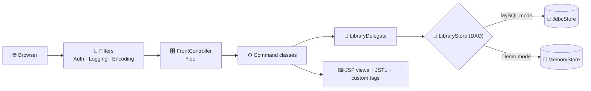
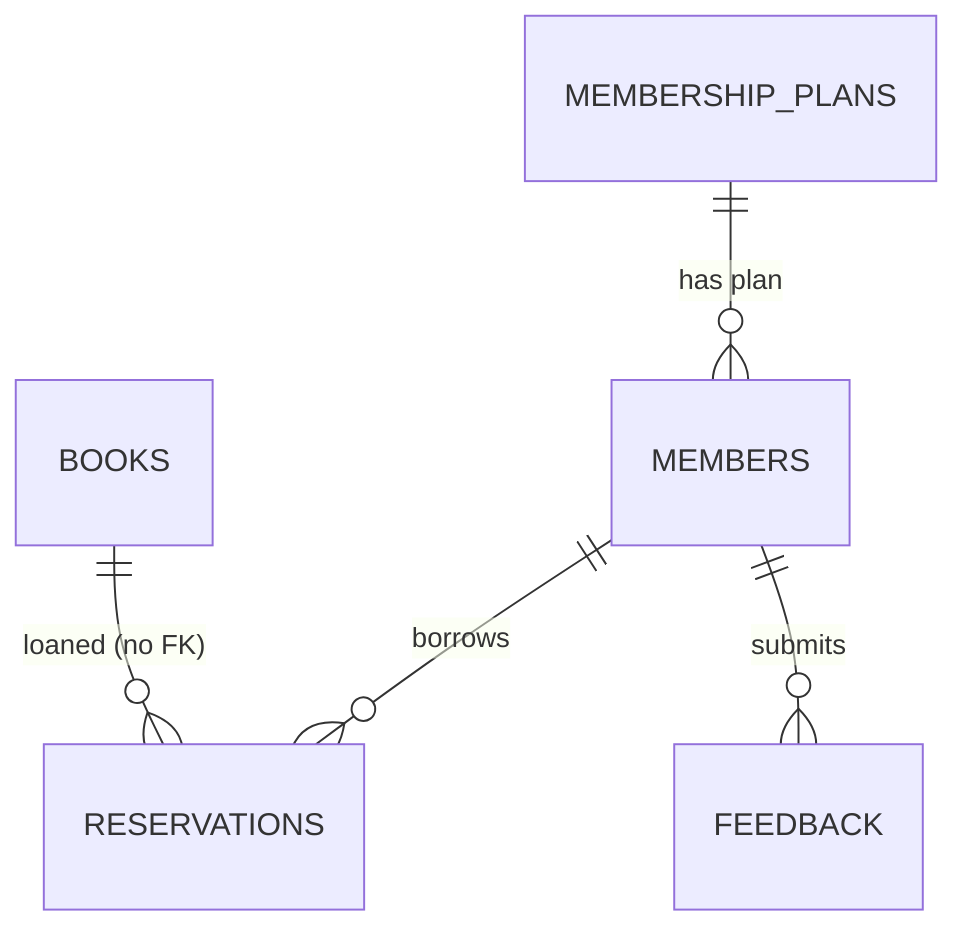

<div align="center">


<a href="https://github.com/Isuru-CodeX/BookVerse">
  
</a>

<br/>

<p>
  
  
  
  
  
</p>

<p>
  
  
  
  
</p>

<p>
  <a href="#-features"><b>✨ Features</b></a> •
  <a href="#-architecture"><b>🏗️ Architecture</b></a> •
  <a href="#-getting-started"><b>🚀 Get Started</b></a> •
  <a href="#-membership-plans"><b>💳 Plans</b></a> •
  <a href="#-database-design"><b>🗄️ Database</b></a> •
  <a href="#-roadmap"><b>🗺️ Roadmap</b></a>
</p>

</div>

---

## 📚 About

**BookVerse** is a JSP-based Java EE web application for library management, built for **HF2K – Web Component Development II (Component A)**. It shows off **Servlet 4.0, JSP 2.3, EL 3.0 and JSTL 1.2** in a realistic app with two audiences: **library members** and **administrative staff**.

> 💡 **Zero-setup friendly:** BookVerse runs in two persistence modes, a **MySQL database mode** (recommended) and an automatic **in-memory demo mode** that kicks in when no database is reachable.

<!--
📸 SCREENSHOTS: add your images to an /assets folder, then uncomment this block.

<div align="center">
  
  
  
  
</div>
-->

---

## ✨ Features

### 👤 Member Portal

| | Feature | What you can do |
|---|---|---|
| 🔎 | **Catalogue search** | Browse and search the book catalogue dynamically, with highlighted matches |
| 📖 | **Reserve and return** | Borrow a title, return it, and keep a reading history |
| 🔄 | **Renewals** | Renew active loans within your plan's renewal limit |
| 💳 | **Membership plans** | Switch between Standard, Premium and Student tiers |
| 💬 | **Feedback and news** | Submit feedback and read library announcements |

### 🛡️ Admin (Staff) Panel

| | Tab | What staff can do |
|---|---|---|
| 📊 | **Overview** | Key stats, overdue loans, sold-out titles |
| 📚 | **Books** | Search, add, edit and delete catalogue entries |
| 👥 | **Members** | Update plans and roles, suspend accounts, reset passwords, view loan history |
| 🔁 | **Loans** | Supervise active, overdue and returned loans; force-return or extend due dates |
| 🧾 | **Plans** | Edit booking rules for every membership tier live |
| 📢 | **Announcements and feedback** | Publish news to the home page and review member feedback |
| 📈 | **Reports** | Most borrowed books and inventory distribution |

---

## 🏗️ Architecture



| Pattern | Where it lives |
|---|---|
| **MVC** | `model/`, `bean/`, `service/` · JSP views · `FrontController` + `command/` |
| **Front Controller** | `FrontController` intercepts every `.do` request and delegates to a `Command` |
| **Command** | `Command` interface with 26 implementing classes |
| **DAO** | `LibraryStore` implemented by `JdbcStore` (MySQL) and `MemoryStore` (in-memory) |
| **Intercepting Filters** | `AuthFilter`, `LoggingFilter`, `EncodingFilter` |
| **Business Delegate and Service Locator** | `LibraryDelegate`, `ServiceLocator` |
| **Listeners** | `AppContextListener`, `SessionCountListener` |

**Core domain models:** 📘 `Book` · 👤 `Member` (roles `STAFF` / `MEMBER`) · 🪪 `MembershipPlan` · 🔖 `Reservation` (a loan and its lifecycle)

---

## 🛠️ Tech Stack

<div align="center">


</div>

| Layer | Technologies |
|---|---|
| **Frontend** | HTML, CSS, JavaScript, JSP 2.3, EL 3.0, JSTL 1.2, custom tags and tag files |
| **Backend** | Java EE (Servlet 4.0), Java 11+ |
| **Database** | MySQL 8 or MariaDB |
| **Tools** | Maven 3.6+, Apache Tomcat 9.x, Git |

---

## 🚀 Getting Started

### ✅ Prerequisites

- ☕ JDK 11 or higher
- 📦 Maven 3.6+
- 🐱 Apache Tomcat **9.x**

  > ⚠️ Tomcat 9 uses the `javax.*` namespace. Tomcat 10+ needs `jakarta.*`.

- 🐬 MySQL 8 / XAMPP / MariaDB *(optional, for database mode)*

### 📥 Installation

```bash
# 1️⃣ Clone the repository
git clone https://github.com/Isuru-CodeX/BookVerse.git
cd BookVerse

# 2️⃣ Build the WAR (includes the MySQL JDBC driver)
mvn clean package
```

### 🗄️ Database setup *(MySQL mode)*

```bash
mysql -u root -p < database/bookverse.sql
```

This creates the `bookverse` database, tables and user, and loads sample data (14 titles, 3 plans).

### ⚙️ Configuration

Connection settings live in `src/main/webapp/WEB-INF/web.xml`:

```xml
<env-entry>
    <env-entry-name>db.url</env-entry-name>
    <env-entry-type>java.lang.String</env-entry-type>
    <env-entry-value>jdbc:mysql://localhost:3306/bookverse?useSSL=false&amp;allowPublicKeyRetrieval=true&amp;serverTimezone=Asia/Colombo</env-entry-value>
</env-entry>
```

Or override with environment variables:

```bash
BOOKVERSE_DB_URL=jdbc:mysql://localhost:3306/bookverse
BOOKVERSE_DB_USER=your_username
BOOKVERSE_DB_PASSWORD=your_password
BOOKVERSE_DB_DRIVER=com.mysql.cj.jdbc.Driver
```

> 🧠 **In-memory mode:** leave `db.url` empty or simply don't start MySQL. Data resets on every restart.

### ▶️ Run it

1. Copy `target/bookverse.war` into `<TOMCAT_HOME>/webapps/`
2. Start Tomcat and open **http://localhost:8080/bookverse/**
3. Check the page footer. It should say **"Data store: MySQL database"** (or the in-memory fallback)

### 🔑 Demo accounts

| Role | Email | Password |
|---|---|---|
| 👤 Member | `member@bookverse.lk` | `member123` |
| 🛡️ Staff | `admin@bookverse.lk` | `admin123` |

---

## 💳 Membership Plans

| Rule | 🥉 Standard | 🥇 Premium | 🎓 Student |
|---|:---:|:---:|:---:|
| Active loans at once | 3 | 8 | 5 |
| Book loan period | 14 days | 28 days | 21 days |
| Journal / magazine loan | 7 days | 14 days | 10 days |
| Renewals per loan | 1 | 3 | 2 |
| Monthly fee | Rs. 500 | Rs. 1,500 | Free |

*These are defaults. Staff can edit every value on the **Plans** tab, and changes apply immediately to new reservations and renewals.*

---

## 🗄️ Database Design



| Table | Purpose | Key columns |
|---|---|---|
| `membership_plans` | Booking rules per plan | PK `type` (STANDARD / PREMIUM / STUDENT) |
| `members` | Accounts (staff and members) | PK `id`, unique `email`, FK `membership_type` |
| `books` | Catalogue | PK `id`, CHECK `available_copies <= total_copies` |
| `reservations` | Loans and history | PK `id`, FK `member_email`, indexes on `book_id`, `status` |
| `announcements` | Home page news | PK `id` |
| `feedback` | Member feedback | PK `id`, CHECK `rating` 1–5 |

> ℹ️ `reservations.book_id` is intentionally **not** a foreign key, so loan history survives when a title is deleted.

---

## 📂 Project Structure

```bash
BookVerse/
├── 📁 src/main/
│   ├── 📁 java/        # Controllers, commands, models, DAOs, services, filters
│   └── 📁 webapp/      # JSP views, CSS, JS, WEB-INF (web.xml, tld, tags)
├── 📁 database/        # bookverse.sql (schema + sample data)
├── 📄 pom.xml          # Maven build
└── 📄 README.md
```

<details>
<summary><b>🧭 Application map (click to expand)</b></summary>

<br/>

| URL | Command | View |
|---|---|---|
| `/` , `index.jsp` | `jsp:forward` → `home.do` | – |
| `home.do` | `HomeCommand` | `views/home.jsp` |
| `catalog.do` | `CatalogCommand` | `views/catalog.jsp` |
| `bookDetail.do?id=` | `BookDetailCommand` | `views/bookDetail.jsp` |
| `login.do` / `logout.do` | `LoginCommand` / `LogoutCommand` | `views/login.jsp` |
| `register.do` | `RegisterCommand` | `views/register.jsp` |
| `dashboard.do` *(member)* | `DashboardCommand` | `views/dashboard.jsp` |
| `reserve.do`, `return.do` *(POST)* | `ReserveCommand`, `ReturnBookCommand` | redirect |
| `plans.do` | `PlansCommand` | `views/plans.jsp` |
| `renew.do`, `changePlan.do` *(POST)* | `RenewCommand`, `ChangePlanCommand` | redirect |
| `admin*.do` *(STAFF only)* | `AdminCommand` and related | `admin.jsp`, `adminBooks.jsp`, `adminMembers.jsp`, `adminLoans.jsp`, `adminPlans.jsp`, `adminAnnouncements.jsp`, `adminFeedback.jsp`, `adminReports.jsp` |
| `elDemo.do` | `ElDemoCommand` | `views/elDemo.jsp` |
| any error / 403 / 404 / 500 | `<error-page>` | `error.jsp` |

**26 JSP files** in total (minimum required: 8).

</details>

<details>
<summary><b>🎓 Where each assessment requirement is implemented (click to expand)</b></summary>

<br/>

| Requirement | Where to look |
|---|---|
| EL implicit objects, `.` and `[]` operators | `views/elDemo.jsp` |
| `jsp:useBean`, `setProperty`, `getProperty` | `catalog.jsp`, `login.jsp`, `register.jsp`, `dashboard.jsp`, `bookDetail.jsp`, `feedback.jsp` |
| `jsp:include` / `jsp:forward` / `jsp:param` | every view, `index.jsp`, `feedback.jsp` |
| JSTL core, `fn:` and `fmt:` | across the views |
| No scriptlets | enforced by `<scripting-invalid>true` in `web.xml` |
| Custom tags | `RatingTag`, `AvailabilityTag`, `HighlightTag` in `WEB-INF/tld/bookverse.tld` |
| Tag files | `card.tag`, `alert.tag`, `pageHeader.tag`, `bookcard.tag`, `elrow.tag`, `adminNav.tag` |
| Security basics | HTML escaping, whitelist redirects, session id change, HttpOnly cookies, POST for state changes, salted password hashes |

</details>

---

## 🧪 Testing

A 33-point **manual test checklist** is documented in the project. Highlights:

- ✅ Search, sort and highlight in the catalogue
- ✅ Custom 404 for invalid book ids, 403 for members opening admin URLs
- ✅ Loan limits, renewals and plan switching enforced per tier
- ✅ XSS payloads in the search box are escaped
- ✅ App still starts (with a warning) if the database is unreachable

```bash
mvn test   # if automated tests are added
```

---

## ⚠️ Known Issues and Assumptions

- A "reservation" is an immediate loan of one copy; limits come from the member's plan.
- Student status is not verified in software (staff check ID at the desk).
- Only two roles exist: `MEMBER` and `STAFF`. Staff accounts are pre-created.
- Ratings are static editorial scores. Members can't rate books yet.
- Passwords use **salted SHA-256** for the demo instead of BCrypt.

---

## 🗺️ Roadmap

- [x] MVC with Front Controller, Command and DAO patterns
- [x] MySQL mode with in-memory fallback
- [x] Full admin dashboard and membership plan editor
- [ ] Connection pooling (HikariCP / Tomcat JDBC pool) and JPA
- [ ] CSRF tokens and BCrypt password hashing
- [ ] Pagination, waiting lists and email notifications
- [ ] REST / JSON API
- [ ] Internationalization with `fmt:message`
- [ ] Unit tests for the service layer
- [ ] Caching of catalogue queries
- [ ] Migration to Jakarta EE 10 / Tomcat 10

---

## 🤝 Contributing

Contributions are welcome!

1. 🍴 Fork the repository
2. 🌿 Create a branch: `git checkout -b feature-name`
3. 💾 Commit: `git commit -m "Add some feature"`
4. 📤 Push: `git push origin feature-name`
5. 🔃 Open a Pull Request

## 📜 License

Created for educational purposes as part of the **HF2K Web Component Development II** assessment.

---

<div align="center">

### 📬 Connect with me

<a href="https://github.com/Isuru-CodeX"></a>

⭐ **If you like BookVerse, give it a star!** ⭐


</div>